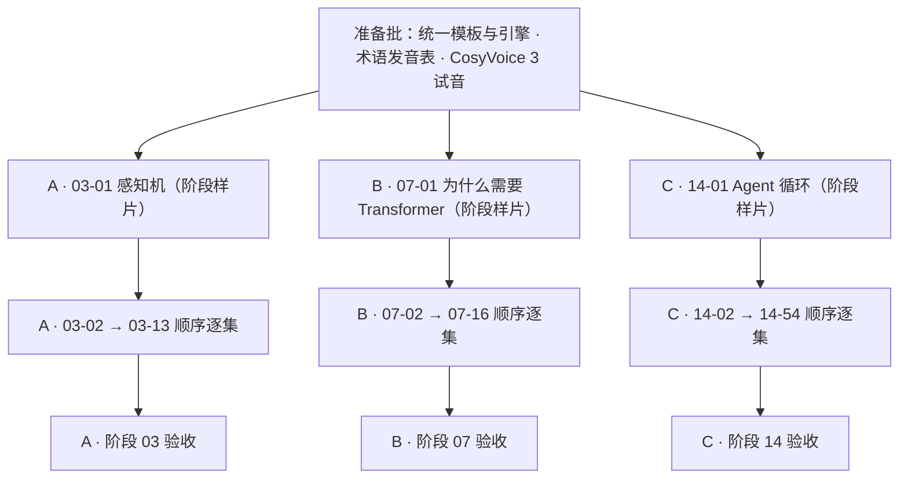

# 用 Hypit 制作「深度学习核心 / Transformer 深入剖析 / Agent 工程」中文短视频系列

> 三个阶段并行推进，阶段内按课号顺序逐集完成，共 83 集中文短视频。

## 制作目标

首批制作 **83 集、16:9 横屏、1280×720、24 fps** 的知识短视频，采用中文旁白、动态图解和代码演示。单集时长按课程复杂度分档，见下节。

覆盖本仓库三个阶段、共 83 节课，集号与课程目录一一对应：

| 流水线 | 阶段 | 名称 | 课程数 |
|---|---|---|---|
| A | 03 | 深度学习核心 | 13 |
| B | 07 | Transformer 深入剖析 | 16 |
| C | 14 | Agent 工程 | 54 |
| | | **合计** | **83** |

分辨率沿用已验证的手绘大画布管线（`spatial:Canvas` 1280×720、24 fps、世界坐标 4400×3400），不改造为 1080p。

### 单集时长分档

按课程 `docs/zh.md` 的结构自动分档，结果在准备批复核后冻结：

| 档位 | 判定 | 场景数 | 画面事件 | 目标时长 |
|---|---|---|---|---|
| T-L 长片 | 含 `## 动手构建` 且 `### 第 N 步` ≥ 3 | 12 | 36 | 4–6 分钟 |
| T-M 中片 | 正文（去代码块）≥ 3000 字符或 `###` 小节 ≥ 4 | 9 | 27 | 3–4 分钟 |
| T-S 短片 | 其余 | 6 | 18 | 2–3 分钟 |

按此规则，本批 83 集分为 T-L 29 集（阶段 03、07 全部）、T-M 42 集、T-S 12 集（阶段 14 的第 43–54 课）。

**三个阶段并行**：三条流水线同时推进，互不阻塞，各阶段独立排期与验收。
**阶段内串行**：每个阶段严格按课号从小到大顺序制作，前一集通过验收后才开始下一集；不使用跨阶段混排的选题顺序。

课程素材来自本仓库。面向具备基础编程能力、希望理解深度学习、Transformer 与 Agent 的观众。每集讲清一个机制，并引导观众阅读原课、运行实验；不将完整课程压缩成逐字朗读。

## 并行编排

准备批完成后一次性释放三条流水线。各阶段首集（03-01、07-01、14-01）作为该阶段样片，用于确认讲解深度、声音、代码可读性与视觉节奏；三条流水线的样片集中评审一次，通过后各自按课号顺序量产，互不等待。

## 流水线 A · 阶段 03 深度学习核心（13 集）

| 集号 | 主题与核心问题 | 对应课程 |
|---|---|---|
| 03-01 | 感知机：一个神经元如何做出线性决策？ | 03／01 |
| 03-02 | 多层网络与前向传播：多堆一层线性变换为什么还不够？ | 03／02 |
| 03-03 | 从零实现反向传播：梯度到底是怎么算出来的？ | 03／03 |
| 03-04 | 激活函数：非线性从哪里来？ | 03／04 |
| 03-05 | 损失函数：模型怎么知道自己错在哪？ | 03／05 |
| 03-06 | 优化器：SGD、Momentum 与 Adam 差在哪？ | 03／06 |
| 03-07 | 正则化：怎样抑制过拟合？ | 03／07 |
| 03-08 | 权重初始化与训练稳定性：一开训就发散，问题出在哪？ | 03／08 |
| 03-09 | 学习率调度与热身：学习率为什么要变？ | 03／09 |
| 03-10 | 搭一个你自己的迷你框架：反向传播如何工程化？ | 03／10 |
| 03-11 | PyTorch 入门：从手写框架到生产框架 | 03／11 |
| 03-12 | JAX 入门：函数式自动微分有什么不同？ | 03／12 |
| 03-13 | 调试神经网络：损失不降时从哪查起？ | 03／13 |

## 流水线 B · 阶段 07 Transformer 深入剖析（16 集）

| 集号 | 主题与核心问题 | 对应课程 |
|---|---|---|
| 07-01 | 为什么需要 Transformer：RNN 的串行与长程依赖问题如何被绕开？ | 07／01 |
| 07-02 | 从零实现 Self-Attention：Q、K、V 各自在做什么？ | 07／02 |
| 07-03 | Multi-Head Attention：为什么要多个头？ | 07／03 |
| 07-04 | Positional Encoding：注意力怎么会知道顺序？ | 07／04 |
| 07-05 | 完整的 Transformer：Encoder 与 Decoder 如何拼装？ | 07／05 |
| 07-06 | BERT：掩码语言建模到底学到了什么？ | 07／06 |
| 07-07 | GPT：因果语言建模如何一步步生成文本？ | 07／07 |
| 07-08 | T5、BART：编码器-解码器架构的取舍 | 07／08 |
| 07-09 | Vision Transformers：图像怎么变成 token 序列？ | 07／09 |
| 07-10 | 音频 Transformer（Whisper）：语音如何转成文本？ | 07／10 |
| 07-11 | Mixture of Experts：参数量与计算量如何解耦？ | 07／11 |
| 07-12 | KV Cache 与 Flash Attention：推理为什么能加速？ | 07／12 |
| 07-13 | Scaling Laws：模型规模与损失之间的幂律关系 | 07／13 |
| 07-14 | 从零构建一个 Transformer：把所有部件装起来 | 07／14 |
| 07-15 | Attention 变体：滑动窗口、稀疏、差分各自解决什么？ | 07／15 |
| 07-16 | 投机解码：草稿与验证如何加速生成？ | 07／16 |

## 流水线 C · 阶段 14 Agent 工程（54 集）

| 集号 | 主题与核心问题 | 对应课程 |
|---|---|---|
| 14-01 | Agent 循环：观察、思考、行动如何闭环？ | 14／01 |
| 14-02 | ReWOO 与 Plan-and-Execute：为什么把规划与执行解耦？ | 14／02 |
| 14-03 | Reflexion：如何用语言反馈替代梯度更新？ | 14／03 |
| 14-04 | Tree of Thoughts 与 LATS：刻意搜索比单条思路强在哪？ | 14／04 |
| 14-05 | Self-Refine 与 CRITIC：迭代改进什么时候真有用？ | 14／05 |
| 14-06 | 工具使用与函数调用：模型选工具，谁来执行？ | 14／06 |
| 14-07 | 虚拟上下文与记忆分页：上下文超限了怎么办？ | 14／07 |
| 14-08 | 记忆块与休眠时计算：记忆如何按需重组？ | 14／08 |
| 14-09 | 混合记忆 Mem0：向量、图与 KV 如何组合？ | 14／09 |
| 14-10 | 技能库与终身学习（Voyager）：Agent 如何积累可复用技能？ | 14／10 |
| 14-11 | 用 HTN 和演化搜索做规划：结构化规划为什么更可靠？ | 14／11 |
| 14-12 | Anthropic 工作流模式：为什么简单方案常常更好？ | 14／12 |
| 14-13 | 有状态图编排：中断后如何从检查点恢复？ | 14／13 |
| 14-14 | Agent 的 Actor 模型：异步消息如何驱动运行时？ | 14／14 |
| 14-15 | 基于角色的 Agent 团队：角色、任务与流程怎么分工？ | 14／15 |
| 14-16 | OpenAI Agents SDK：Handoffs、Guardrails、Tracing 各解决什么？ | 14／16 |
| 14-17 | Harness 即库：子 agent 与会话存储如何组织？ | 14／17 |
| 14-18 | 生产级运行时：快速实例化与类型化工作流 | 14／18 |
| 14-19 | 基准（SWE-bench、GAIA、AgentBench）：怎样衡量 Agent 能力？ | 14／19 |
| 14-20 | 基准（WebArena、OSWorld）：真实环境评测难在哪？ | 14／20 |
| 14-21 | Computer Use：Agent 怎么操作图形界面？ | 14／21 |
| 14-22 | 语音 Agent：Pipecat 与 LiveKit 的实时链路 | 14／22 |
| 14-23 | OpenTelemetry GenAI 语义约定：Agent 链路怎么标准化埋点？ | 14／23 |
| 14-24 | Agent 可观测性：Langfuse、Phoenix、Opik 各自看什么？ | 14／24 |
| 14-25 | 多 Agent 辩论：多视角真能提升正确率吗？ | 14／25 |
| 14-26 | 失败模式：agent 为什么会坏？ | 14／26 |
| 14-27 | Prompt 注入与 PVE 防御：工具返回内容为何不能直接当指令？ | 14／27 |
| 14-28 | 编排模式：Supervisor、Swarm、Hierarchical 如何选？ | 14／28 |
| 14-29 | 生产运行时：Queue、Event、Cron 各自适合什么任务？ | 14／29 |
| 14-30 | 评估驱动的 Agent 开发：如何证明任务完成，而非只看回答？ | 14／30 |
| 14-31 | Agent 工作台工程：能干的模型为什么还会失败？ | 14／31 |
| 14-32 | 最小 Agent 工作台：一个能跑的最小骨架长什么样？ | 14／32 |
| 14-33 | 指令即可执行约束：指令如何变成可校验的规则？ | 14／33 |
| 14-34 | 仓库记忆与持久状态：跨会话的状态存在哪里？ | 14／34 |
| 14-35 | Agent 初始化脚本：每次开工的环境如何固定？ | 14／35 |
| 14-36 | 范围契约与任务边界：如何防止 agent 越界？ | 14／36 |
| 14-37 | 运行时反馈循环：如何让工具结果回流成修正？ | 14／37 |
| 14-38 | 验证关卡：满足什么条件才允许交付？ | 14／38 |
| 14-39 | 审查者 Agent：为什么要把构建者和打分者分开？ | 14／39 |
| 14-40 | 多会话交接：上下文如何无损传递给下一个会话？ | 14／40 |
| 14-41 | 真实仓库上的工作台：规模上去后哪里先崩？ | 14／41 |
| 14-42 | 综合项目：交付一个可复用的 Agent 工作台包 | 14／42 |
| 14-43 | 在 agent 写代码前框定任务：任务框定为什么决定成败？ | 14／43 |
| 14-44 | 制定由证据支撑的执行计划：计划如何从证据生长出来？ | 14／44 |
| 14-45 | 通过隔离与合并契约委派工作：并行委派如何不打架？ | 14／45 |
| 14-46 | 把每次纠正变成系统改进：反馈如何沉淀成机制？ | 14／46 |
| 14-47 | 在选择产出前定义结果：产出与结果差在哪？ | 14／47 |
| 14-48 | 发现人们实际执行的工作流：调研为什么要看现场？ | 14／48 |
| 14-49 | 绘制假设地图：先化解风险最高的那一项 | 14／49 |
| 14-50 | 选择最小可测试切片：怎样挑出能改变决定的那一步？ | 14／50 |
| 14-51 | 编写保留判断空间的规格说明：规格为什么不能写死？ | 14／51 |
| 14-52 | 在结果出现前设计成功指标 | 14／52 |
| 14-53 | 有意识地选择原型、试点或生产 | 14／53 |
| 14-54 | 构建带所有权与淘汰机制的反馈棘轮 | 14／54 |

## 制作流程与 Hypit 实现

- **建立独立制作工程：** 放在 `/Users/lirichen/Work/GithubRepo/hypit-productions/ai-engineering-zh`，与已验证的参考工程 `self-attention-whiteboard` 同级，使用 [Hypit](https://github.com/hypit-ai/hypit) 0.2.17 作为制作工具。视频制作时课程仓库只读，视频工程保存讲稿、图形组件、素材、制作源文件和结果。三条流水线在同一工程内按 `<阶段编号>-<课编号>` 分目录，共用引擎但不共享单集状态，任一流水线阻塞不影响其余两条。
- **提取课程依据：** 从中文讲义、代码、测验和术语表整理每集学习目标、关键结论、演示方法及来源。逐集记录课程 Git 提交，便于后续更新追踪。
- **改编视频脚本：** 每个场景写 3 段旁白，按“问题 → 机制 → 示例 → 边界 → 原课练习”组织；每段 110–180 字，T-L 档整集约 4000–6000 字。实际时长以配音测量结果为准，超过该档上限时删减内容而不是放慢语速。
- **统一视觉模板：** 准备批制作标题卡、机制图、代码高亮、运行结果和总结卡五类可复用组件，三条流水线共用。代码每屏以 5–10 行为主；公式、标识符保持准确，字幕避免遮挡演示区域。
- **区分图解与证据：** 概念关系用可编辑动画；声称代码运行成功时展示真实执行结果。需要外部模型的演示采用明确标注的确定性模拟，首批不新增课程模型调用费用。
- **配音与时间编排：** 使用内网自建 CosyVoice 3（`FunAudioLLM/Fun-CosyVoice3-0.5B-2512`，`http://172.16.12.71:8097`，`cosy.remote` Provider），音色 `default`。按完整段落合成、保留模型段内停顿，只在场景之间插入 0.65 秒、片尾 1 秒。用配音对齐字幕及语义事件，驱动图解与代码变化。三条流水线共用同一音色与发音表，保证系列一致性。
- **时间线与字幕：** 每场景 WAV 经 Whisper small 词时间戳（ASR）定位三句边界，与已核对讲稿做字符匹配；ASR 仅用于辅助定时，字幕内容始终取自讲稿。低覆盖率必须检查边界与音频，不得下调阈值让脚本通过。
- **验证和导出：** 使用 SVML 编排、Recipe 生成素材、SVRun 选择生成或复用结果；依次执行 `check`、`plan`、`build`。通过 Studio 检视，并观看、听审最终 MP4。

每集交付 MP4、SRT 字幕、封面、发布文案、课程链接和可编辑制作源文件，按 `<阶段编号>-<课编号>` 命名。系列另交付选题总表与三条流水线各自的进度表；不新增 Hypit 核心公共 API。

## 分批安排与验收

1. **准备批：** 完成统一模板与引擎参数化、术语发音表、CosyVoice 3 试音，以及三条流水线的脚本规范。此批不产出成片。
2. **样片批：** 并行完成 03-01、07-01、14-01，集中评审讲解深度、声音、代码可读性和视觉节奏；按流水线分别调整，必要时重新试音。
3. **量产批：** 三条流水线各自按课号顺序推进，A 线 03-02→03-13，B 线 07-02→07-16，C 线 14-02→14-54。每条流水线在相邻两集之间设置一个检查点，逐集验收后放行下一集。

验收要求：

- 每集时长落在所属档位区间内（T-L 4–6 分钟、T-M 3–4 分钟、T-S 2–3 分钟），输出 1280×720、24 fps；字幕与音画同步，无截字、遮挡或明显音频问题。
- 技术结论可追溯到课程来源；删减后仍保留必要前提，模拟结果有明确标注。
- 代码演示运行对应检查，结果与画面一致；字幕和旁白准确读出关键术语。
- 修改旁白后，关联动画能随语义位置调整；重建时可复用未变素材，失败后不重复生成已完成配音。
- 每条流水线单独记录进度：已完成集号、当前集、阻塞原因。阶段验收要求该阶段覆盖 100% 课号、无缺集，且全集完整观看、听审。
- 样片与每条流水线的最终视频均完整观看、听审，再交付。

## 默认条件与费用边界

- 首批覆盖阶段 03、07、14 的全部课程。阶段 11（LLM 工程）、13（工具与协议），以及基础数学、模型训练与认证课程留待后续系列；原 12 集选题中来自 11、13 阶段的主题不在本批范围，来自 14 阶段的主题由 14-06、14-07、14-27、14-30 等集承接。
- 配音使用内网自建 CosyVoice 3，不产生第三方 TTS 账单，**第三方语音 API 费用为 ¥0**；仍有内网 GPU、存储与运维成本。若内网服务不可用，启用云端 TTS 属于预算外变更，须先取得用户对服务与额度上限的明确授权。
- 视频生成模型、白板渲染（Hypit / HyperFrames）、字幕辅助对齐（Whisper small）与编码（FFmpeg）均为本地或自建，费用 ¥0。
- 当前已核验：CosyVoice 3 服务 `172.16.12.71:8097` 返回 `status: ready`、Hypit CLI 0.2.17 可执行。Hypit Runtime、浏览器与字体的可用性仍需在准备批按实际运行确认。
- 首批不使用数字人或生成视频素材。发布平台暂不绑定，交付通用横屏文件与文案，不自动上传。
- 三条流水线并行会同时占用配音、审片和存储资源；若出现资源冲突，按 C（14）→ B（07）→ A（03）的优先级让行，但不得改变任一阶段内部的课号顺序。
